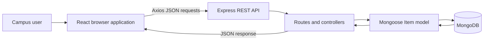

# CampusFind
## Campus Lost-and-Found Portal

### Project Report

**Submitted to:** DCollege  
**Submitted by:** [Student Name]  
**Roll / Registration No.:** [Roll Number]  
**Course / Department:** [Course and Department]  
**Project guide:** [Guide Name]  
**Academic year:** [Academic Year]

---

## Certificate

This is to certify that the project report titled **“CampusFind: Campus Lost-and-Found Portal”** is submitted by **[Student Name]**, Roll / Registration No. **[Roll Number]**, in partial fulfillment of the requirements for **[Course / Programme]** at **DCollege**. The work described in this report was completed under the guidance of **[Guide Name]**.

**Project guide:** ____________________  
**Head of Department:** ____________________  
**Date:** ____________________  
**College seal:** ____________________

> Complete this certificate with the college's approved wording and obtain the required signatures before submission.

## Declaration

I, **[Student Name]**, declare that this project report, titled **“CampusFind: Campus Lost-and-Found Portal,”** describes work completed for academic purposes. To the best of my knowledge, the report is an accurate account of the application and its current limitations. Any external resources used are listed in the references.

**Student signature:** ____________________  
**Date:** ____________________

## Acknowledgment

I would like to thank **[Guide Name]** for guidance and feedback during this project. I also thank the faculty and staff of **DCollege**, and everyone who provided suggestions that helped shape the CampusFind application.

## Abstract

CampusFind is a full-stack web application intended to make campus lost-and-found reporting easier to organize and search. Students can submit a report for an item they have lost or found, browse recent reports, search report titles and descriptions, and filter by item type, category, and status. A report contains the item's description, category, location, date, and the submitter's contact details. Users can view, edit, delete, resolve, or reopen reports.

The application uses React and Vite in the browser, an Express and Node.js REST API on the server, and MongoDB accessed through Mongoose for persistence. The browser sends JSON requests through Axios. The API validates input, applies filters, performs database operations, and returns JSON responses. The interface includes dashboard statistics, form validation, loading and error feedback, empty states, and a responsive layout.

CampusFind is an academic demonstration rather than a production service. It currently has no authentication or authorization, and contact names and email addresses are visible to users. These limitations should be addressed before deployment for real campus use.

**Keywords:** Lost and found, campus portal, MERN stack, React, Express, MongoDB, REST API.
    
## Table of Contents

1. [Introduction](#1-introduction)
2. [Project Objectives and Scope](#2-project-objectives-and-scope)
3. [Requirements and Feasibility](#3-requirements-and-feasibility)
4. [System Analysis and Design](#4-system-analysis-and-design)
5. [Implementation](#5-implementation)
6. [Testing and Evaluation](#6-testing-and-evaluation)
7. [Limitations and Future Enhancements](#7-limitations-and-future-enhancements)
8. [Conclusion](#8-conclusion)
9. [References](#9-references)
10. [Appendix A: Setup and Operation](#appendix-a-setup-and-operation)

---

## 1. Introduction

### 1.1 Background

On a campus, personal belongings are regularly misplaced or found in classrooms, libraries, laboratories, offices, and shared areas. When information is spread across informal messages or physical notices, a person searching for an item may not know where to look, and reports can be difficult to keep current.

CampusFind provides a shared, searchable list of lost and found item reports. A report can be created with identifying details and a location, then marked resolved when the item is reunited with its owner. The application is designed for a small campus community and demonstrates a complete browser-to-database workflow.

### 1.2 Problem Statement

There is a need for a simple way for campus users to publish and find lost-and-found information. The system should organize reports consistently, allow users to narrow the results, and provide a way to contact the report submitter. It should also make it possible to update report information and indicate whether an item has been reunited with its owner.

### 1.3 Proposed Solution

CampusFind provides a web dashboard for browsing and searching reports, a form for creating and editing reports, and a details page for contacting the submitter and managing report status. An Express API validates requests and reads or writes report records in MongoDB.

### 1.4 Intended Users

The intended users are members of a campus community who need to report or search for a lost or found item. The current application does not create user accounts or distinguish between students, staff, and administrators; any user who can reach the application can use the available report operations.

## 2. Project Objectives and Scope

### 2.1 Objectives

- Provide a centralized place to publish lost and found reports.
- Support creating, viewing, editing, deleting, resolving, and reopening reports.
- Make reports easier to locate with text search and combined filters.
- Persist reports in MongoDB so they remain available after a browser refresh.
- Validate submitted data in both the user interface and the API.
- Present loading, error, empty, and success feedback to users.
- Demonstrate a React, Express, Node.js, and MongoDB application with a REST API.

### 2.2 Scope

The current implementation covers:

- Reports with type `Lost` or `Found`.
- Categories: Electronics, Documents / ID Cards, Bags, Accessories, Books / Stationery, Keys, and Other.
- Status values `Open` and `Resolved`.
- Search across report titles and descriptions.
- Filtering by type, category, and status.
- Dashboard counts for total reports, open lost reports, open found reports, and resolved reports.
- A report detail page with a mail link for the listed contact email.
- MongoDB persistence and API health reporting.

The application does not currently include accounts, permissions, image attachments, moderation, notifications, pagination, or an audit history.

## 3. Requirements and Feasibility

### 3.1 Functional Requirements

| ID | Requirement |
| --- | --- |
| FR-01 | The system shall allow a user to submit a lost or found item report. |
| FR-02 | The system shall require a title, description, category, type, location, date, contact name, and valid contact email. |
| FR-03 | The system shall list reports, ordered from newest to oldest. |
| FR-04 | The system shall search report titles and descriptions and allow type, category, and status filters to be combined. |
| FR-05 | The system shall display an individual report and its contact information. |
| FR-06 | The system shall allow report fields to be edited and a report to be deleted. |
| FR-07 | The system shall allow a report to be marked `Resolved` or reopened as `Open`. |
| FR-08 | The system shall display dashboard statistics and useful loading, error, empty, and success messages. |
| FR-09 | The API shall return JSON responses and appropriate client-error responses for invalid inputs and missing records. |

### 3.2 Non-Functional Requirements

- **Usability:** Provide clear labels, validation feedback, and simple report-management flows.
- **Responsive presentation:** Adapt the interface to different screen sizes.
- **Maintainability:** Separate the browser UI, API routes, controller logic, database model, and configuration.
- **Data persistence:** Store report records in MongoDB rather than only in browser state.
- **Configuration:** Read the database URI, server port, frontend origin, and API URL from environment configuration where applicable.
- **Error handling:** Return structured JSON errors and avoid sending server stack traces to API clients.
- **Privacy awareness:** Clearly warn users that contact details are public in this academic version.

### 3.3 Hardware and Software Requirements

**Development software**

- Node.js 20 or later and npm.
- MongoDB Community Server running locally, or a MongoDB Atlas database.
- A modern web browser.
- A code editor and terminal.

**Application technologies**

- Frontend: React 18, Vite, JavaScript/JSX, React Router DOM, Axios, and CSS.
- Backend: Node.js, Express, Mongoose, dotenv, and cors.
- Database: MongoDB.

### 3.4 Feasibility

- **Technical feasibility:** The project uses commonly available JavaScript and MongoDB tooling. Its frontend and backend run as separate development processes and communicate over HTTP.
- **Operational feasibility:** The core workflow is straightforward for a campus user: create a report, search or filter, contact the submitter, and update the status.
- **Economic feasibility:** The application can be developed and run locally using the listed open-source technologies. Hosting and managed database costs would depend on a future deployment choice.

## 4. System Analysis and Design

### 4.1 Architecture

The system has three main layers:

1. **Presentation layer:** React pages and reusable components render the dashboard, forms, and report details.
2. **Application/API layer:** Express routes dispatch HTTP requests to controller functions, which validate input and perform the requested operation.
3. **Data layer:** Mongoose models map report data to MongoDB documents.



### 4.2 Main Modules

| Module | Responsibility |
| --- | --- |
| Dashboard (`Home`) | Loads reports and statistics; manages search, filters, and report-list states. |
| Report form (`ItemForm`) | Creates or edits a report and performs browser-side validation. |
| Report details (`ItemDetails`) | Shows report information, toggles status, and requests deletion confirmation. |
| Edit page (`EditItem`) | Loads an existing report and passes it to the shared form. |
| Item service | Sends API requests through a configured Axios client and exposes readable error messages. |
| Item routes and controller | Implements list, create, read, update, delete, and status-update API operations. |
| Item model | Defines the MongoDB document fields, enumerations, and timestamps. |
| Error middleware | Handles unknown routes and formats API errors. |
| Database configuration | Connects the server to the configured MongoDB instance. |

### 4.3 User Workflow

1. A user opens the dashboard and views recent reports and summary counts.
2. The user searches or applies one or more filters to narrow the report list.
3. The user opens a report to view its description, location, date, status, and contact details.
4. The user may edit or delete the report, or mark it resolved/reopen it.
5. To publish a report, the user completes the form. Browser validation provides immediate feedback; the API validates the submitted values again before saving.
6. MongoDB stores the report. The API responds with JSON and the browser updates the interface.

### 4.4 Data Model

The `Item` model maps to the MongoDB `items` collection. MongoDB supplies the document identifier (`_id`); Mongoose manages `createdAt` and `updatedAt`.

| Field | Type | Constraints / Purpose |
| --- | --- | --- |
| `title` | String | Required; trimmed item title. |
| `description` | String | Required; trimmed identifying details. |
| `category` | String | Required; one of the seven supported categories. |
| `type` | String | Required; `Lost` or `Found`. |
| `location` | String | Required; campus location associated with the report. |
| `date` | Date | Required; date the item was lost or found. |
| `contactName` | String | Required; trimmed report submitter name. |
| `contactEmail` | String | Required; trimmed and stored in lowercase. |
| `status` | String | `Open` or `Resolved`; defaults to `Open`. |
| `createdAt`, `updatedAt` | Date | Automatically maintained timestamps. |

### 4.5 API Design

Base URL: `http://localhost:5000/api`

| Method | Endpoint | Purpose |
| --- | --- | --- |
| `GET` | `/health` | Reports API and MongoDB health. |
| `GET` | `/items` | Lists reports; accepts `search`, `type`, `category`, and `status` query parameters. |
| `GET` | `/items/:id` | Retrieves one report by MongoDB ID. |
| `POST` | `/items` | Creates a report and returns HTTP `201` on success. |
| `PUT` | `/items/:id` | Updates one or more permitted report fields. |
| `PATCH` | `/items/:id/status` | Sets status to `Open` or `Resolved`. |
| `DELETE` | `/items/:id` | Deletes a report. |

Successful responses use a JSON envelope containing `success: true` and `data`, with a message for mutations. Error responses contain `success: false` and a message. The API returns `400` for invalid input or malformed IDs, `404` for missing records or routes, and a generic `500` message for unexpected server errors.

Search is case-insensitive and checks the title and description. Search input is escaped before it is used in a regular expression. Results are ordered by `createdAt` descending.

## 5. Implementation

### 5.1 Frontend

The frontend is a single-page React application. React Router maps `/` to the dashboard, `/report` to the report form, `/items/:id` to report details, and `/items/:id/edit` to the edit form. Unknown paths show a not-found page.

Reusable components provide item cards, search and filter controls, statistics cards, loading feedback, error messages, navigation, and empty states. The dashboard fetches filtered reports and report statistics. The shared form supports both new reports and edits, trims submitted text values, and validates required fields, email addresses, and dates before sending a request.

The Axios service reads its API base URL from `VITE_API_URL`, defaulting to `http://localhost:5000/api`. It converts API and network failures to messages that the interface can display.

### 5.2 Backend

The Express application enables JSON request parsing and CORS for the configured frontend origin. Routes delegate to controller functions. The controllers validate required fields, enumerated values, email format, and MongoDB identifiers; they also restrict updates to known report fields. Mongoose schema validation is enabled for updates as an additional data-integrity check.

The error middleware handles malformed JSON, Mongoose validation and cast errors, unknown API routes, and unexpected server errors. The server connects to MongoDB before it begins listening for HTTP requests.

### 5.3 Environment Configuration

The server reads `PORT`, `MONGODB_URI`, and `CLIENT_URL` from `server/.env`. The frontend reads `VITE_API_URL` from `client/.env`. Example environment files are supplied in the project. Real credentials and connection strings should remain in local environment files and must not be committed to source control.

## 6. Testing and Evaluation

### 6.1 Testing Approach

The project contains separate frontend and backend packages. The frontend package provides a Vite production-build command; the package manifests do not define a dedicated automated test suite. The following cases form a manual functional test plan. They should be executed against a running API and MongoDB instance before submission or deployment; this report does not claim that these cases have been executed.

### 6.2 Functional Test Cases

| ID | Test | Expected result |
| --- | --- | --- |
| TC-01 | Open the dashboard with a reachable API and database. | Recent reports and dashboard statistics load. |
| TC-02 | Submit a report with all required valid fields. | The API creates the report; it appears in the report list and persists after refresh. |
| TC-03 | Submit with a required field blank. | The form identifies the missing field and does not submit. |
| TC-04 | Submit with an invalid email address. | The form and API reject the invalid email. |
| TC-05 | Search for a word in a report title or description. | Matching reports are shown without regard to letter case. |
| TC-06 | Combine type, category, status, and search filters. | Only reports matching all selected criteria are listed. |
| TC-07 | Open a report, edit a field, and save. | The updated report is shown after the save. |
| TC-08 | Mark an open report resolved, then reopen it. | The status changes between `Open` and `Resolved`, and the dashboard counts reflect the status on refresh. |
| TC-09 | Cancel the delete confirmation. | The report remains unchanged. |
| TC-10 | Confirm deletion of a report. | The report is removed and the user returns to the dashboard. |
| TC-11 | Request a malformed ID or a non-existent report. | The API returns an appropriate client error or not-found response. |
| TC-12 | Stop the API or database and load the application. | The interface provides an error state rather than showing the request as successful. |

### 6.3 Evaluation

The implemented design covers the core lost-and-found lifecycle: report creation, discovery, contact, editing, and resolution. Server-side validation complements browser-side checks so invalid data is not accepted solely because a client-side check was bypassed. MongoDB persistence makes report data available across browser sessions. The primary operational and privacy risks are the absence of authentication and the public display of contact details.

## 7. Limitations and Future Enhancements

### 7.1 Current Limitations

- There is no authentication or authorization. Anyone with access can create, edit, resolve, reopen, or delete reports.
- Contact names and email addresses are visible on report details.
- Reports do not support item photographs or attachments.
- The list has no pagination or archival workflow.
- There is no moderation, notification service, or audit trail.
- Automated API and UI tests are not included in the package scripts.
- The application is configured as a local/development project; production deployment requirements have not been implemented here.

### 7.2 Future Enhancements

1. Add authenticated accounts and role-based permissions.
2. Hide email addresses behind a private contact or messaging relay.
3. Add image upload with file type, size, and access controls.
4. Add moderation, report flagging, and audit history.
5. Add pagination and more scalable search/indexing for larger datasets.
6. Notify users about potential matches or status changes.
7. Add automated API and browser tests and run them in continuous integration.
8. Deploy with HTTPS, production environment configuration, backups, monitoring, and security review.

## 8. Conclusion

CampusFind demonstrates a full-stack solution for organizing campus lost-and-found reports. Its React interface communicates with an Express REST API, and Mongoose persists report data in MongoDB. Users can create and search reports, apply filters, view contact details, edit or delete entries, and update report status.

The project meets its academic objective of demonstrating a connected frontend, API, and database workflow with validation and user feedback. Its current lack of access control and privacy protections means it should remain a demonstration until suitable production safeguards are implemented.

## 9. References

1. React documentation, https://react.dev/
2. Vite documentation, https://vite.dev/guide/
3. Express documentation, https://expressjs.com/
4. MongoDB documentation, https://www.mongodb.com/docs/
5. Mongoose documentation, https://mongoosejs.com/docs/
6. Axios documentation, https://axios-http.com/docs/intro
7. CampusFind project README and source code.

---

## Appendix A: Setup and Operation

### A.1 Prerequisites

Install Node.js 20 or later and npm. Start a local MongoDB Community Server instance, or prepare a MongoDB Atlas connection string and network access configuration.

### A.2 Configure and start the backend

In PowerShell, from the project directory:

```powershell
cd C:\path\to\CampusFind\server
Copy-Item .env.example .env
npm install
npm run dev
```

Set `MONGODB_URI` in `server/.env` to the local database URI or the Atlas connection string. The default local URI is `mongodb://127.0.0.1:27017/campusfind`. The API listens on port `5000` by default.

### A.3 Configure and start the frontend

In a second PowerShell terminal:

```powershell
cd C:\path\to\CampusFind\client
Copy-Item .env.example .env
npm install
npm run dev
```

Open the Vite URL printed in the terminal, normally `http://localhost:5173`. The frontend's default API URL is `http://localhost:5000/api`. Set `VITE_API_URL` in `client/.env` if the API is hosted at another URL.

### A.4 Production frontend build

From `client`:

```powershell
npm run build
```

### A.5 Example API requests

Check API and database health:

```powershell
Invoke-RestMethod http://localhost:5000/api/health
```

List open found accessories matching a search:

```powershell
Invoke-RestMethod 'http://localhost:5000/api/items?search=wallet&type=Found&category=Accessories&status=Open'
```
